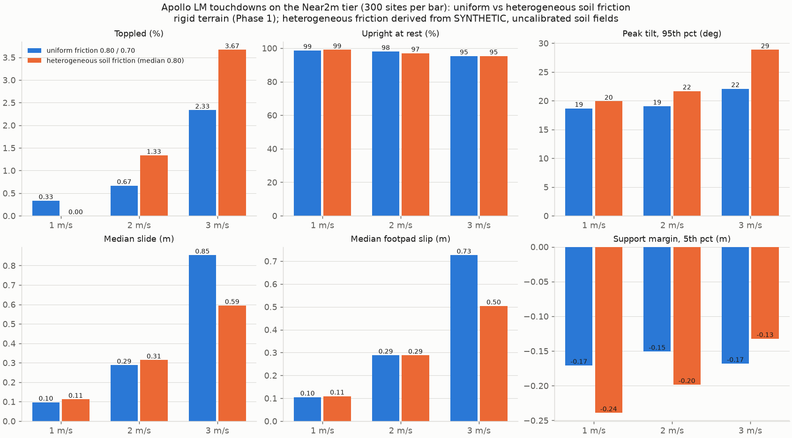
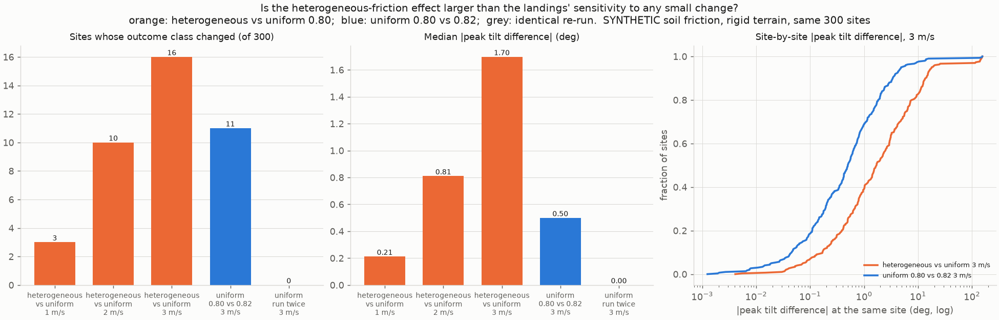
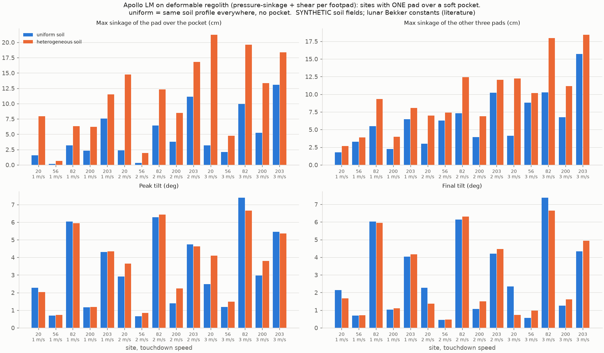
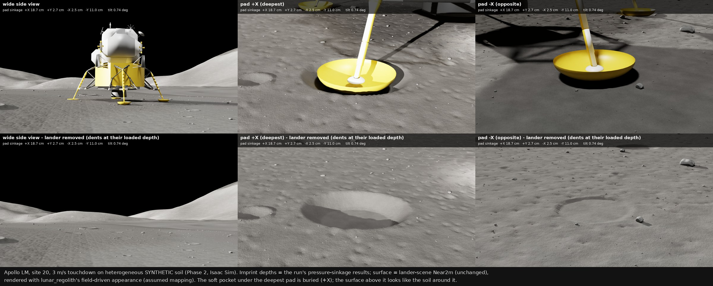
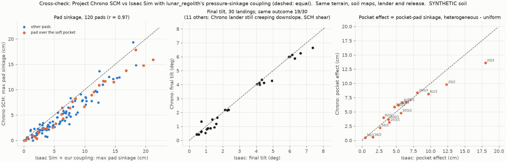
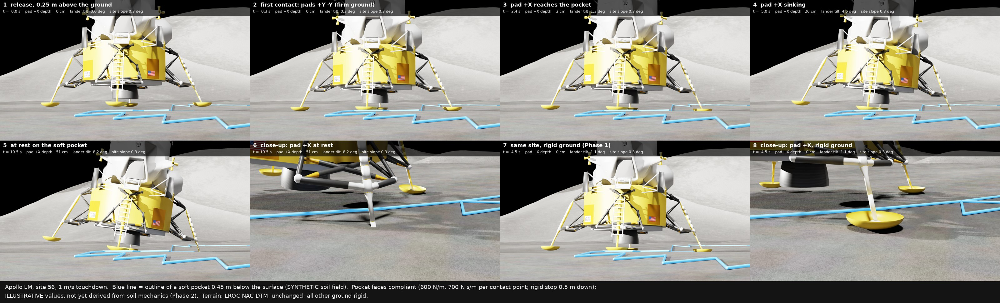
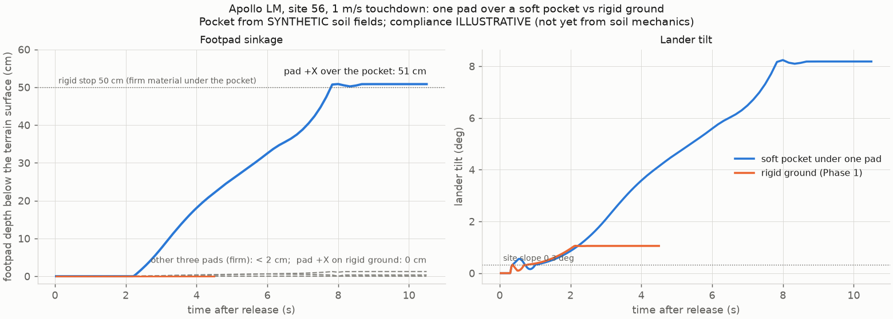

# Lunar touchdown on heterogeneous regolith

**Question.** Can a lunar lander touch down safely when its footpads meet different soil conditions? Imagine three
pads landing on firm ground while the fourth meets a soft subsurface pocket. That pad sinks further, which causes
differential settlement, shifts the load distribution, and can produce a dangerous roll or pitch.

The study uses the **Apollo 17 landing site** (real LROC NAC terrain), the **Apollo Lunar Module** (NASA mass
properties) in **NVIDIA Isaac Sim 6 / PhysX**, and **synthetic, spatially correlated regolith** generated on the same
terrain.

> All soil properties and friction values in this study are **synthetic and uncalibrated**. They come from procedural
> soil fields, not measurements. Only the terrain surface (LROC NAC DTM) is observed data. Results compare scenarios;
> they are not predictions for the real Taurus-Littrow soil.

## Architecture

```
NAC terrain -> heterogeneous subsurface -> general soil-contact model -> lander touchdown -> rover mobility -> autonomous operations
 (lunar_regolith)   (lunar_regolith)           (lunar_regolith.contact)    (THIS STUDY)          (future)             (future)
```

| Component | Repository | Role here |
|---|---|---|
| `external/lunar_regolith` | [MEO41/lunar_regolith](https://github.com/MEO41/lunar_regolith) | Synthetic soil fields on the DTM. Also the **general soil-contact model**: patch-averaged soil under a contact, interface friction, USD friction zones. Rovers will reuse it later. |
| `external/apollo_lander_modeling` | [MEO41/isaac-lunar-terrain-setup-apollo](https://github.com/MEO41/isaac-lunar-terrain-setup-apollo) | Apollo LM and the Apollo 17 scene in Isaac Sim: exact terrain colliders, lander mass properties, Isaac launcher. |
| this repository | MEO41/lunar_touchdown_study | Experiments, run scripts, analysis and write-up. |

Both dependencies are **git submodules pinned to exact commits**, and every result file records the commits of all
three repositories that produced it.

## Phases

| Phase | Content | Status |
|---|---|---|
| **1. Static heterogeneous terrain** | NAC terrain as a USD collider with **spatially varying friction materials** from the soil fields. Footpad contacts are linked to soil properties. Touchdowns on real slopes and uneven ground, measuring stability and footpad load distribution. | done (findings below) |
| 2. Deformable regolith | Per-footpad soil queries, pressure-sinkage, differential penetration, shear and lateral displacement, terrain deformation, soft pockets and depth-dependent layers, coupled to the lander's 6-DoF dynamics. | in progress (first results below) |
| 3. Uncertain terrain, risk-aware control | Estimating soil before touchdown, landing-site suitability, predicting differential settlement, trajectories and touchdown speeds, control robust to uncertain soil, partial or asymmetric contact. | later |

## Setup

```bash
git clone --recurse-submodules https://github.com/MEO41/lunar_touchdown_study.git && cd lunar_touchdown_study
# lunar_regolith: its own venv (soil generation, contact model, analysis)
python3 -m venv external/lunar_regolith/.venv && external/lunar_regolith/.venv/bin/pip install -e "external/lunar_regolith[test,usd]"
# apollo_lander_modeling: Isaac Sim 6 environment + data + scene (see its README): .env.local (ISAAC_ENV), ./download_data.sh, ./build_scene.sh
```

To use existing working copies that already hold the data, copy `.env.example` to `.env.local` and set
`LANDER_REPOSITORY` and `REGOLITH_REPOSITORY`.

## Phase 1: running it

```bash
experiments/phase1_static_friction/run_phase1.sh all       # or step by step:
experiments/phase1_static_friction/run_phase1.sh soil      # soil maps on the lander DTM + friction overlay for the Near2m collider
experiments/phase1_static_friction/run_phase1.sh gate      # PhysX gate test of per-face friction zones
experiments/phase1_static_friction/run_phase1.sh touchdown 1 2 3   # 300 sites x {uniform, heterogeneous} x speeds
experiments/phase1_static_friction/run_phase1.sh annotate  # soil state under every footpad
experiments/phase1_static_friction/run_phase1.sh plot      # comparison tables, paired statistics and figures
```

Controls (3 m/s; written to `results/phase1/repeatability/` and picked up by the plot step):

```bash
eval "$(python3 common/study_paths.py)"; T=experiments/phase1_static_friction/heterogeneous_touchdown_test.py; R=results/phase1/repeatability
"$LANDER_ISAAC_RUNNER" $T --friction-mode uniform --touchdown-speed 3 --out $R/heterogeneous_touchdown_uniform_v3_repeat.json
"$LANDER_ISAAC_RUNNER" $T --friction-mode uniform --uniform-friction 0.82 0.7175 --touchdown-speed 3 --out $R/heterogeneous_touchdown_uniform_v3_perturbed_mu0.82.json
```

**Phase 1 method**
- **Terrain:** the lander scene's `Near2m` tier (1.2 km, 2 m DTM, exact triangle-mesh collider, rigid).
- **Friction:** `lunar_regolith contact-overlay` writes a USD layer assigning **8 friction zones** to its 720,000 faces,
  with μ<sub>s</sub> 0.46–1.10 and an area median of 0.80. Uniform runs use 0.80 / 0.70 everywhere, so the two modes
  differ only in spatial variation.
- **Lander:** the footpads carry a μ = 1 contact material, and the terrain materials use PhysX's `multiply` combine
  mode, so each pad feels exactly the zone value. The gate test verifies this.
- **Touchdowns:** at an exact vertical speed (1, 2 and 3 m/s) on 300 Near2m sites.
- **Recorded:** per-pad contact order, load-share history, slip, the friction zone under each pad, peak and final tilt,
  the minimum support margin of the centre of mass, the outcome class, and the patch-averaged soil under each pad.
  The soil record includes soft-pocket coverage, flagged for Phase 2.

### Phase 1 findings

**Runs executed.** The main suite: 300 Near2m sites × {uniform 0.80 / 0.70, heterogeneous} × {1, 2, 3 m/s}, which is 1,800
touchdowns. Two controls at 3 m/s on the same 300 sites: an identical re-run, and uniform friction nudged to 0.82 / 0.7175. Gate test
re-run from this repository. Numbers come from `results/phase1/heterogeneous_touchdown_summary.json`.

| touchdown speed | toppled: uniform / heterogeneous | upright at rest | sites whose outcome changed | McNemar p (toppling) | median \|Δ peak tilt\| |
|---|---|---|---|---|---|
| 1 m/s | 1 / 0 | 296 / 297 | 3 | 1.00 | 0.2° |
| 2 m/s | 2 / 4 | 294 / 291 | 10 | 0.63 | 0.8° |
| 3 m/s | 7 / 11 | 286 / 286 | 16 | 0.34 | 1.7° |
| *control, 3 m/s:* uniform 0.80 vs **0.82** | 7 / 8 | 286 / 285 | 11 | 1.00 | 0.5° |
| *control, 3 m/s:* identical re-run | 7 / 7 | 286 / 286 | 0 | – | 0.0° (300/300 bit-identical) |

1. **The PhysX gate test passes 12/12**, including the re-run from this repository. Per-face friction zones are honoured, and the
   measured dynamic friction matches the zone values within 0.001 (for example 0.406 and 0.966).
2. **The earlier drop-test baseline ran with less friction than intended.** The lander in `apollo_lander_modeling` had no physics
   material, so PhysX averaged its default 0.5 with the regolith's 0.8 / 0.7. The effective friction was **0.65 / 0.60**, not
   0.80 / 0.70. All runs in this study set the footpad material explicitly.
3. **The simulation is deterministic.** An unchanged re-run reproduces all 300 landings exactly, so every difference below comes from
   the friction change.
4. **Spatially varying friction did not measurably change touchdown safety on rigid terrain.**
   - Toppling went from 1 / 2 / 7 to 0 / 4 / 11 landings. None of the paired differences is significant (exact McNemar p ≥ 0.34).
   - The outcome changes (3 / 10 / 16 of 300 sites) are of the same order as those caused by a 0.02 change in *uniform* friction
     (11 sites at 3 m/s).
   - Landings near the stability limit flip under any small perturbation. Heterogeneous friction perturbs them more (median tilt
     difference 1.7° vs 0.5°) but not in a consistent direction.
   - Slide shows small, deterministic differences of opposite sign at 1 and 3 m/s (median +0.02 m and −0.09 m), so there is no
     consistent friction effect on slide either.
5. **Why: the four pads rarely feel different friction.**
   - The synthetic friction field is correlated over 60 m × 30 m, but the pads stand 5.7 m (adjacent) and 8 m (opposite) apart.
   - In 161–172 of 300 landings, every loaded pad sits in the same friction zone.
   - Only about 40 landings per speed have a pad-to-pad contrast above 0.2. Even in that subset there is no consistent effect
     (McNemar p ≥ 0.5).
   - Footpad slip hardly depends on the friction under the pad: the per-zone medians are flat from μ<sub>s</sub> 0.46 to 1.10.
6. **Slope decides toppling.** Every toppled landing was on a site steeper than 9°, most between 14° and 23°. Only 21 of the 300
   sites are steeper than 14°.
7. **What this means for the research question.** At the scale of these synthetic soil fields, friction heterogeneity is a
   second-order effect for the Apollo LM. The mechanism the question is about needs Phase 2: one pad sinking into a soft pocket while
   the others stay on firm ground.
   - The soil annotation already identifies the test cases. 15% of the pads stand over a synthetic soft pocket.
   - About 26 landings per speed have one pad over a pocket and another pad clear of it (pocket area fractions differ by more than
     0.5). These are the differential-settlement cases.

*Correction applied in the analysis.* The main-suite result files recorded each pad's continuous face friction instead of the zone
value PhysX applies; the zone id itself was recorded correctly. The analysis reads the applied value back from the overlay's zone
table, and the touchdown script now records both values. The simulations were not affected.

| | |
|---|---|
|  |  |
| Outcome rates and dynamics, uniform vs heterogeneous | Heterogeneous effect against the sensitivity control and the identical re-run |
|  |  |
| The same site in both modes | Footpad slip against the friction zone under the pad |

## Phase 2: deformable regolith (first results)

```bash
experiments/phase2_deformable/run_phase2.sh all    # select -> columns -> soil-touchdown (Isaac) -> soil-plot
```

**Soil model.** The model is general and lives in `lunar_regolith.contact.sinkage`; it uses numpy only, so Isaac can load it.
- **Loading.** The Reece form of Bekker's law, anchored to lunar values (Wong, after Costes et al.: n = 1, k<sub>c</sub> = 1.4 kN/m², k<sub>φ</sub> = 820 kN/m³). It scales with friction angle like Meyerhof's bearing-capacity factors; that scaling is an assumption.
- **Layers.** Each sample's stiffness is a stress-weighted harmonic mean over the soil below the pad, so a soft pocket within reach counts.
- **Unloading.** Sinkage is permanent: the soil springs back along a stiff unloading line (10× the loading stiffness).
- **Shear.** Hysteretic Janosi shear (K = 1.8 cm).
- **Damping.** Proportional to the current stiffness.
- **Soil data.** The soil comes from the synthetic soil columns around each site.

**Coupling (lander side, `soil_touchdown.py`).**
- **Collision.** The footpads and the lowest leg parts no longer collide with the terrain; the body, engine bell and upper legs still collide rigidly.
- **Pads.** Each pad is on a ball joint, so it lies flat on the soil and transmits no moment. Its sinkage is the depth of the pad centre below the unchanged DTM surface.
- **Soil under each pad.** It is sampled at 19 points over the 0.91 m disc.
- **Forces.** Each pad's normal and shear force is applied at the pad centre before every physics step, through PhysX's tensor API. The simulation runs at 480 Hz with a 0.003 s damping time constant; that combination keeps the coupling numerically stable even on firm soil.
- **Final loads.** These are averaged over the last second, because a lightly loaded pad sitting at the bottom of its own dent chatters in and out of contact.

**Experiment.**
- **Sites.** The 5 sites where exactly one pad stands over a shallow soft pocket.
- **Speeds.** Touchdown at 1, 2 and 3 m/s.
- **Soils.** Heterogeneous soil (as generated) against a uniform control, in which every column is the site's median pocket-free column. That gives 30 touchdowns in total.

| site (pocket pad) | pocket pad, max sinkage, uniform → heterogeneous (1 / 2 / 3 m/s) | differential sinkage, heterogeneous | final tilt, uniform → heterogeneous (3 m/s) |
|---|---|---|---|
| 20 (+X) | 1.5 → 8.0 / 2.4 → 14.8 / 3.2 → 21.2 cm | 6.5 / 11.7 / 16.4 cm | 2.4° → 0.7° |
| 56 (+X) | 0.1 → 0.6 / 0.3 → 1.9 / 2.1 → 4.7 cm | 3.9 / 5.9 / 6.6 cm | 0.6° → 1.0° |
| 82 (+X) | 3.2 → 6.3 / 6.4 → 12.3 / 9.9 → 19.6 cm | 8.3 / 10.1 / 17.0 cm | 7.4° → 6.6° |
| 200 (+Y) | 2.3 → 6.2 / 3.8 → 8.5 / 5.2 → 13.3 cm | 4.9 / 5.3 / 7.5 cm | 1.3° → 1.6° |
| 203 (−X) | 7.5 → 11.5 / 11.1 → 16.8 / 13.0 → 18.3 cm | 5.9 / 8.4 / 4.4 cm | 4.3° → 4.9° |

1. **The pad over the soft pocket sinks 1.4 to 6 times deeper than on uniform soil.** It reaches up to 21 cm at 3 m/s. The
   differential settlement between pads reaches 17 cm.
2. **Even so, no landing toppled, and the tilt barely changed.** All 30 landings end upright on three pads. The final tilt changes by
   −1.6° to +0.6°, and the peak tilt never exceeds 7.4°. **Slope still dominates.**
3. **The direction of the effect depends on where the pocket is.** At site 20 the soft pad is on the high side, so its sinking levels
   the lander (2.4° → 0.7°). Elsewhere the soft pad tilts the lander slightly further.
4. **A pocket matters only if its pad carries load.** At site 56 the LM stands on its ±Y diagonal, and pad +X over the pocket carries
   only 2–3% of the weight. That pad hardly sinks (0.6–4.7 cm).
5. **The uniform control is not "the same soil minus the pocket".** The other pads also sink deeper on the heterogeneous soil,
   because the median pocket-free column is firmer than much of the generated soil around these sites. Isolating the pocket alone
   needs a pocket-removed control (planned).

**Limits.** The soil is synthetic. The stiffness scaling, unloading factor and damping are assumptions. The leg struts are rigid:
the LM's crushable shock absorbers are not modelled, so all impact energy goes into the soil. Rut memory is reset when a pad moves
by more than its radius. Bulldozing (passive soil resistance on the pad rim) is not modelled.



### Rendered: the lander in its imprints

`run_phase2.sh appearance [site] [speed] [mode]` takes one Phase 2 landing and renders it on lunar_regolith's
field-driven surface, with each footpad sitting in its own imprint. It runs three steps:

1. It re-runs the landing with `--record-poses`. For site 20 at 3 m/s on heterogeneous soil, the re-run
   reproduces the suite: pocket pad 18.7 cm, tilt 0.735° against 0.728°.
2. `build_touchdown_appearance.py` builds the render scene.
   - **Surface:** the lander scene's `Near2m` tier, the surface the sinkage was measured against, refined exactly
     near the lander. `Near2m` itself is unchanged and only hidden for rendering.
   - **Imprint depth:** each pad's final sinkage, or the permanent dent if the pad has lifted.
   - **Wall slope:** the local soil friction angle.
   - **Check:** the rendered floor depth equals the simulated sinkage (difference 1e-16 m).
3. `render_touchdown_appearance.py` renders the scene in Isaac Sim with path tracing. The lander stands at its
   recorded rest pose. The same views are repeated without the lander, so the dents are visible.



At site 20 the +X pad sits 18.7 cm deep, over the buried soft pocket. Seen from above, the surface over the pocket
looks like the soil around it: the pocket starts 0.3–0.6 m down, and the appearance reflects only surface fields.
Only the depth of the dent reveals the pocket. The soil and the appearance mapping are synthetic and assumed.

### Cross-check with Project Chrono SCM

```bash
experiments/phase2_crosscheck/run_crosscheck.sh all   # export -> plate -> touchdown (PyChrono) -> compare; needs CHRONO_PYTHON in .env.local
```

[Project Chrono](https://projectchrono.org) is an open-source multibody engine (BSD-3) from outside this project. Its SCM deformable terrain implements the same
soil laws (Bekker–Wong pressure-sinkage, Janosi shear) on a grid that deforms. The cross-check reruns all 30 Phase 2 touchdowns in
SCM with identical inputs:
- the same Near2m terrain patch (SCM deforms only its own copy);
- per-location SCM parameters from the same soil columns (our layered curve linearised to a single Bekker stiffness at 5 cm sinkage, plus our shallow strength, unloading stiffness and damping);
- the same lander mass properties;
- the same release state.

The footpads here are separate discs on **spherical joints**, as on the real LM.

**Setup used.** PyChrono 10.0.0 with the vehicle module, from the `projectchrono` conda channel; the conda-forge build has no SCM.
- **Mesh position.** SCM's mesh initialisation needs the mesh near the origin, so every scenario runs in a frame centred on its site.
- **Pad mass.** 50 kg pad discs keep the ball-jointed pads stable at 1 ms steps.
- **Step size.** Firm control soil at site 20 needed 0.25 ms (refined automatically when a run diverged).
- **Grid.** SCM grid 0.1 m; 0.05 m gave the same pad sinkage to within 0.4 cm.

**Results.**
- **Plate test.** A 0.91 m footpad disc was pushed into flat SCM soil with lunar_regolith's reference lunar soil. SCM's loading
  pressure is **1.011× ours** at the median. Unloading releases the pressure at **8.978 cm in SCM against 8.990 cm in ours**. The two
  implementations of the law agree.
- **30 touchdowns.** Pad sinkage correlates at **r = 0.97** (median difference −1.2 cm). Final tilt differs by **0.15°** at the median.
  The **pocket effect** (pocket-pad sinkage, heterogeneous minus uniform) correlates at **r = 0.96**. No landing toppled in either
  engine.
- **Where they differ.**
  - **Deep sinkage (above about 12 cm).** Chrono sinks less, because its single stiffness per point cannot represent our layered
    curve, which softens as the loaded zone reaches deeper soft layers. Layering matters exactly where pockets act.
  - **Sloped sites (4°, sites 82 and 203).** The Chrono lander keeps creeping 2–5 mm/s downslope at an unchanged tilt, so 11 of 30
    landings never pass the rest test there. SCM's slip formulation lets a statically loaded pad keep slipping, while our hysteretic
    Janosi shear holds.

**What it confirms.** An independent engine and contact formulation reproduces our coupling's sinkage, tilt and pocket effect.
That includes a different pad model: real ball joints instead of force points. So the Phase 2 conclusions do not hinge on our own
implementation.

**What it cannot confirm.** The soil constants themselves. Both engines use the same assumed parameters. Calibrating them needs
particle (DEM) or continuum (CRM) virtual plate tests, or measured data. That is the next step.



## Phase 2 preview: one footpad sinking into a soft pocket (illustrative compliance)

```bash
experiments/phase2_deformable/run_phase2.sh all     # select -> simulate (Isaac) -> render (Isaac, RTX) -> plot
```

**Site.** The site is picked from the Phase 1 soil annotation (`select_soft_pocket_site.py`):
- one pad stands over a synthetic soft pocket starting at most 0.7 m down;
- the other three pads have no pocket under them;
- the site is gentle and upright in Phase 1.

The chosen site is **site 56**: slope 0.3°, pocket under pad +X starting 0.45 m below the surface.

**Simulation.** The 406 Near2m faces above the pocket get a **compliant contact material**: a PhysX spring and damper per contact
point, 600 N/m and 700 N s/m. A rigid stop 0.5 m down stands for the firm material under the pocket. All other ground stays rigid,
and the same site is also run fully rigid. These compliance values are **illustrative**: they were chosen so that the pocket visibly
gives way. They are not yet derived from soil mechanics; deriving them is the Phase 2 work.

**Result (1 m/s).**

| | soft pocket under pad +X | rigid ground |
|---|---|---|
| depth of pad +X | **51 cm**, reaching the stop | 0 cm |
| depth of the other three pads | under 2 cm | 0 cm |
| final tilt (site slope 0.3°) | **8.2°** | 1.1° |

- **Sequence.** Pads +Y and −Y touch down first at 0.3 s. The lander rolls onto +X at 2.4 s, and that pad sinks for about 5 s until
  it reaches the stop. The opposite pad, −X, ends up 59 cm above the ground.
- **What it shows.** The mechanism of the research question, differential settlement turning into tilt, works in the engine and can
  be measured.
- **What is still illustrative.** The sinkage depth and its rate follow from the illustrative stiffness and stop depth, so they are
  not predictions.




## Layout

```
common/study_paths.py                     paths (.env.local / submodules) and git provenance
experiments/phase2_deformable/            run_phase2.sh, select_soft_pocket_site.py, prepare_soil_columns.py, soil_touchdown.py (Isaac),
                                          plot_soil_touchdown.py; preview: render_soft_pocket_touchdown.py (Isaac), plot_soft_pocket_touchdown.py
                                          appearance: build_touchdown_appearance.py, render_touchdown_appearance.py (Isaac)
experiments/phase2_crosscheck/            run_crosscheck.sh, export_chrono_inputs.py, chrono_plate_test.py (PyChrono), chrono_scm_touchdown.py (PyChrono),
                                          compare_chrono_isaac.py
common/landing_geometry.py                terrain surface, slope, support margin, footpad geometry (shared by the touchdown scripts)
experiments/phase1_static_friction/       run_phase1.sh, verify_friction_zones_in_physx.py (Isaac), heterogeneous_touchdown_test.py (Isaac),
                                          annotate_footpad_soil.py, plot_heterogeneous_touchdown.py
external/                                 pinned submodules: lunar_regolith, apollo_lander_modeling
results/                                  run outputs (git-ignored): phase1/{soil_contact, friction_gate, touchdown, repeatability, logs}
docs/images/                              curated figures
```
