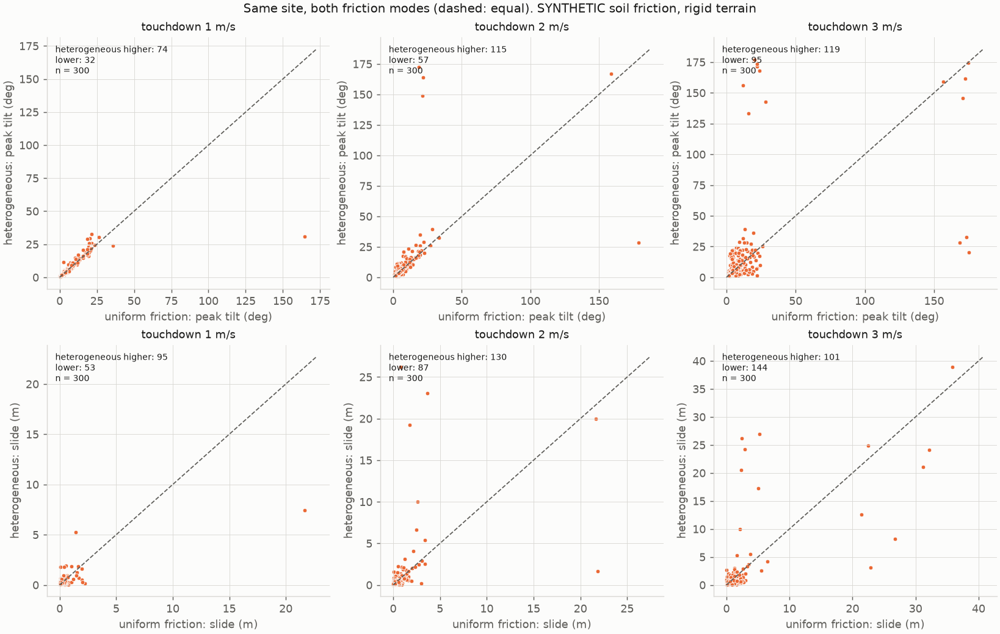
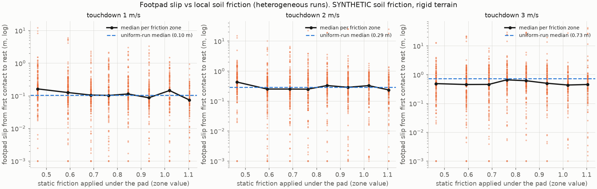

# Lunar touchdown on heterogeneous regolith

**Question.** Can a lunar lander touch down safely when its footpads meet different soil conditions? Imagine three
pads landing on firm ground while the fourth meets a soft subsurface pocket. That pad sinks further, which causes
differential settlement, shifts the load distribution, and can produce a dangerous roll or pitch.

The study uses the **Apollo 17 landing site** (real LROC NAC terrain), the **Apollo Lunar Module** (NASA mass
properties) in **NVIDIA Isaac Sim 6 / PhysX**, and **synthetic, spatially correlated regolith** generated on the same
terrain.

> All soil properties and friction values in this study are **synthetic and uncalibrated**. They come from procedural
> soil fields, not measurements. Only the terrain surface (LROC NAC DTM) is observed data. Results compare scenarios;
> they are not predictions for the real Taurus-Littrow soil.

## Architecture

```
NAC terrain -> heterogeneous subsurface -> general soil-contact model -> lander touchdown -> rover mobility -> autonomous operations
 (lunar_regolith)   (lunar_regolith)           (lunar_regolith.contact)    (THIS STUDY)          (future)             (future)
```

| Component | Repository | Role here |
|---|---|---|
| `external/lunar_regolith` | [MEO41/lunar_regolith](https://github.com/MEO41/lunar_regolith) | Synthetic soil fields on the DTM. Also the **general soil-contact model**: patch-averaged soil under a contact, interface friction, USD friction zones. Rovers will reuse it later. |
| `external/apollo_lander_modeling` | [MEO41/isaac-lunar-terrain-setup-apollo](https://github.com/MEO41/isaac-lunar-terrain-setup-apollo) | Apollo LM and the Apollo 17 scene in Isaac Sim: exact terrain colliders, lander mass properties, Isaac launcher. |
| this repository | MEO41/lunar_touchdown_study | Experiments, run scripts, analysis and write-up. |

Both dependencies are **git submodules pinned to exact commits**, and every result file records the commits of all
three repositories that produced it.

## Phases

| Phase | Content | Status |
|---|---|---|
| **1. Static heterogeneous terrain** | NAC terrain as a USD collider with **spatially varying friction materials** from the soil fields. Footpad contacts are linked to soil properties. Touchdowns on real slopes and uneven ground, measuring stability and footpad load distribution. | done (findings below) |
| 2. Deformable regolith | Per-footpad soil queries, pressure-sinkage, differential penetration, shear and lateral displacement, terrain deformation, soft pockets and depth-dependent layers, coupled to the lander's 6-DoF dynamics. | next |
| 3. Uncertain terrain, risk-aware control | Estimating soil before touchdown, landing-site suitability, predicting differential settlement, trajectories and touchdown speeds, control robust to uncertain soil, partial or asymmetric contact. | later |

## Setup

```bash
git clone --recurse-submodules https://github.com/MEO41/lunar_touchdown_study.git && cd lunar_touchdown_study
# lunar_regolith: its own venv (soil generation, contact model, analysis)
python3 -m venv external/lunar_regolith/.venv && external/lunar_regolith/.venv/bin/pip install -e "external/lunar_regolith[test,usd]"
# apollo_lander_modeling: Isaac Sim 6 environment + data + scene (see its README): .env.local (ISAAC_ENV), ./download_data.sh, ./build_scene.sh
```

To use existing working copies that already hold the data, copy `.env.example` to `.env.local` and set
`LANDER_REPOSITORY` and `REGOLITH_REPOSITORY`.

## Phase 1: running it

```bash
experiments/phase1_static_friction/run_phase1.sh all       # or step by step:
experiments/phase1_static_friction/run_phase1.sh soil      # soil maps on the lander DTM + friction overlay for the Near2m collider
experiments/phase1_static_friction/run_phase1.sh gate      # PhysX gate test of per-face friction zones
experiments/phase1_static_friction/run_phase1.sh touchdown 1 2 3   # 300 sites x {uniform, heterogeneous} x speeds
experiments/phase1_static_friction/run_phase1.sh annotate  # soil state under every footpad
experiments/phase1_static_friction/run_phase1.sh plot      # comparison tables, paired statistics and figures
```

Controls (3 m/s; written to `results/phase1/repeatability/` and picked up by the plot step):

```bash
eval "$(python3 common/study_paths.py)"; T=experiments/phase1_static_friction/heterogeneous_touchdown_test.py; R=results/phase1/repeatability
"$LANDER_ISAAC_RUNNER" $T --friction-mode uniform --touchdown-speed 3 --out $R/heterogeneous_touchdown_uniform_v3_repeat.json
"$LANDER_ISAAC_RUNNER" $T --friction-mode uniform --uniform-friction 0.82 0.7175 --touchdown-speed 3 --out $R/heterogeneous_touchdown_uniform_v3_perturbed_mu0.82.json
```

**Phase 1 method**
- **Terrain:** the lander scene's `Near2m` tier (1.2 km, 2 m DTM, exact triangle-mesh collider, rigid).
- **Friction:** `lunar_regolith contact-overlay` writes a USD layer assigning **8 friction zones** to its 720,000 faces,
  with μ<sub>s</sub> 0.46–1.10 and an area median of 0.80. Uniform runs use 0.80 / 0.70 everywhere, so the two modes
  differ only in spatial variation.
- **Lander:** the footpads carry a μ = 1 contact material, and the terrain materials use PhysX's `multiply` combine
  mode, so each pad feels exactly the zone value. The gate test verifies this.
- **Touchdowns:** at an exact vertical speed (1, 2 and 3 m/s) on 300 Near2m sites.
- **Recorded:** per-pad contact order, load-share history, slip, the friction zone under each pad, peak and final tilt,
  the minimum support margin of the centre of mass, the outcome class, and the patch-averaged soil under each pad.
  The soil record includes soft-pocket coverage, flagged for Phase 2.

### Phase 1 findings

**Runs executed.** The main suite: 300 Near2m sites × {uniform 0.80 / 0.70, heterogeneous} × {1, 2, 3 m/s}, which is 1,800
touchdowns. Two controls at 3 m/s on the same 300 sites: an identical re-run, and uniform friction nudged to 0.82 / 0.7175. Gate test
re-run from this repository. Numbers come from `results/phase1/heterogeneous_touchdown_summary.json`.

| touchdown speed | toppled: uniform / heterogeneous | upright at rest | sites whose outcome changed | McNemar p (toppling) | median \|Δ peak tilt\| |
|---|---|---|---|---|---|
| 1 m/s | 1 / 0 | 296 / 297 | 3 | 1.00 | 0.2° |
| 2 m/s | 2 / 4 | 294 / 291 | 10 | 0.63 | 0.8° |
| 3 m/s | 7 / 11 | 286 / 286 | 16 | 0.34 | 1.7° |
| *control, 3 m/s:* uniform 0.80 vs **0.82** | 7 / 8 | 286 / 285 | 11 | 1.00 | 0.5° |
| *control, 3 m/s:* identical re-run | 7 / 7 | 286 / 286 | 0 | – | 0.0° (300/300 bit-identical) |

1. **The PhysX gate test passes 12/12**, including the re-run from this repository. Per-face friction zones are honoured, and the
   measured dynamic friction matches the zone values within 0.001 (for example 0.406 and 0.966).
2. **The earlier drop-test baseline ran with less friction than intended.** The lander in `apollo_lander_modeling` had no physics
   material, so PhysX averaged its default 0.5 with the regolith's 0.8 / 0.7. The effective friction was **0.65 / 0.60**, not
   0.80 / 0.70. All runs in this study set the footpad material explicitly.
3. **The simulation is deterministic.** An unchanged re-run reproduces all 300 landings exactly, so every difference below comes from
   the friction change.
4. **Spatially varying friction did not measurably change touchdown safety on rigid terrain.**
   - Toppling went from 1 / 2 / 7 to 0 / 4 / 11 landings. None of the paired differences is significant (exact McNemar p ≥ 0.34).
   - The outcome changes (3 / 10 / 16 of 300 sites) are of the same order as those caused by a 0.02 change in *uniform* friction
     (11 sites at 3 m/s).
   - Landings near the stability limit flip under any small perturbation. Heterogeneous friction perturbs them more (median tilt
     difference 1.7° vs 0.5°) but not in a consistent direction.
   - Slide shows small, deterministic differences of opposite sign at 1 and 3 m/s (median +0.02 m and −0.09 m), so there is no
     consistent friction effect on slide either.
5. **Why: the four pads rarely feel different friction.**
   - The synthetic friction field is correlated over 60 m × 30 m, but the pads stand 5.7 m (adjacent) and 8 m (opposite) apart.
   - In 161–172 of 300 landings, every loaded pad sits in the same friction zone.
   - Only about 40 landings per speed have a pad-to-pad contrast above 0.2. Even in that subset there is no consistent effect
     (McNemar p ≥ 0.5).
   - Footpad slip hardly depends on the friction under the pad: the per-zone medians are flat from μ<sub>s</sub> 0.46 to 1.10.
6. **Slope decides toppling.** Every toppled landing was on a site steeper than 9°, most between 14° and 23°. Only 21 of the 300
   sites are steeper than 14°.
7. **What this means for the research question.** At the scale of these synthetic soil fields, friction heterogeneity is a
   second-order effect for the Apollo LM. The mechanism the question is about needs Phase 2: one pad sinking into a soft pocket while
   the others stay on firm ground.
   - The soil annotation already identifies the test cases. 15% of the pads stand over a synthetic soft pocket.
   - About 26 landings per speed have one pad over a pocket and another pad clear of it (pocket area fractions differ by more than
     0.5). These are the differential-settlement cases.

*Correction applied in the analysis.* The main-suite result files recorded each pad's continuous face friction instead of the zone
value PhysX applies; the zone id itself was recorded correctly. The analysis reads the applied value back from the overlay's zone
table, and the touchdown script now records both values. The simulations were not affected.

| | |
|---|---|
|  |  |
| Outcome rates and dynamics, uniform vs heterogeneous | Heterogeneous effect against the sensitivity control and the identical re-run |
|  |  |
| The same site in both modes | Footpad slip against the friction zone under the pad |

## Layout

```
common/study_paths.py                     paths (.env.local / submodules) and git provenance
experiments/phase1_static_friction/       run_phase1.sh, verify_friction_zones_in_physx.py (Isaac), heterogeneous_touchdown_test.py (Isaac),
                                          annotate_footpad_soil.py, plot_heterogeneous_touchdown.py
external/                                 pinned submodules: lunar_regolith, apollo_lander_modeling
results/                                  run outputs (git-ignored): phase1/{soil_contact, friction_gate, touchdown, repeatability, logs}
docs/images/                              curated figures
```
